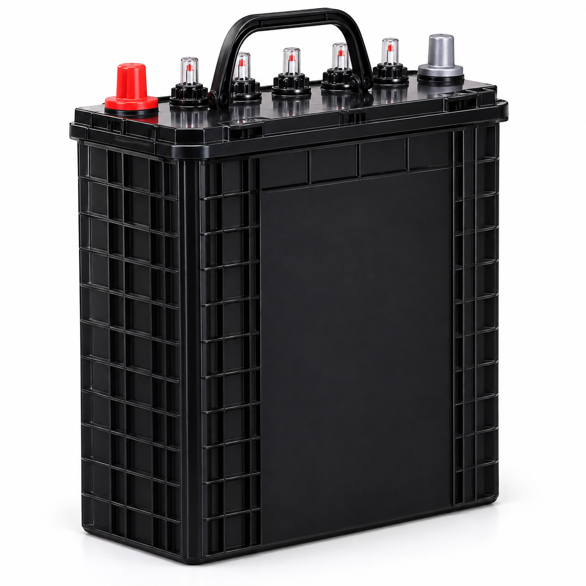

# LIMITED OFFER Banner Fix - Changes Summary

## Date: November 24, 2026

## Changes Made

### 1. Backup Created
- **File**: `index-backup-banner.html`
- **Purpose**: Safety backup before making changes to the banner

### 2. HTML Structure Updated (Lines 3612-3628)

**Old Structure:**
```html
<div class="offer-banner__text">
    <!-- content -->
</div>
<div class="offer-banner__image">
    
</div>
```

**New Structure:**
```html
<div class="offer-banner__content">
    <span class="offer-banner__label">LIMITED OFFER</span>
    <h2 class="offer-banner__title">Up to 35% OFF on Solar Tubular Batteries</h2>
    <p class="offer-banner__description">Tubular batteries, genuine warranty, free delivery over Rs 20,000</p>
    
    <!-- NEW: Features list with checkmarks -->
    <div class="offer-banner__features">
        <div class="offer-banner__feature">
            <i data-lucide="check-circle" class="offer-banner__check"></i> Genuine warranty
        </div>
        <div class="offer-banner__feature">
            <i data-lucide="check-circle" class="offer-banner__check"></i> Free delivery over Rs 20,000
        </div>
        <div class="offer-banner__feature">
            <i data-lucide="check-circle" class="offer-banner__check"></i> Nepal-wide support
        </div>
    </div>
    
    <a href="#shop" class="offer-banner__btn" onclick="...">Shop Batteries</a>
</div>

<!-- NEW: Visual column with badge and styled image panel -->
<div class="offer-banner__visual">
    <div class="offer-banner__badge">35% OFF</div>
    <div class="offer-banner__image-panel">
        
    </div>
</div>
```

### 3. CSS Updates (Lines 2114-2238)

#### Main Container
```css
.offer-banner {
    padding: 40px 48px;              /* Was: 48px all sides */
    grid-template-columns: 55% 45%;  /* Was: 1.2fr 1fr */
    gap: 32px;                       /* Was: 40px */
}
```

#### Left Column (Content)
```css
.offer-banner__content {            /* Was: __text */
    text-align: left;                /* NEW: explicitly left-aligned */
    max-width: 100%;                 /* NEW: width constraint */
}
```

#### NEW: Features List
```css
.offer-banner__features {
    display: flex;
    flex-direction: column;
    gap: 10px;
    margin-top: 4px;
}

.offer-banner__feature {
    display: flex;
    align-items: center;
    gap: 10px;
    font-size: 15px;
    color: rgba(255, 255, 255, 0.85);
}

.offer-banner__check {
    width: 18px;
    height: 18px;
    color: var(--amber-500);
    flex-shrink: 0;
}
```

#### Button (Enhanced)
```css
.offer-banner__btn {
    padding: 14px 32px;              /* Was: 12px 28px */
    color: white;                    /* Was: var(--navy-900) */
    font-weight: 700;                /* Was: 600 */
    border: none;                    /* NEW */
    cursor: pointer;                 /* NEW */
}
```

#### Right Column (Visual)
```css
.offer-banner__visual {              /* Was: __image */
    position: relative;              /* NEW: for badge positioning */
}

.offer-banner__badge {               /* NEW */
    position: absolute;
    top: 12px;
    right: 12px;
    background: var(--amber-500);
    color: white;
    font-size: 14px;
    font-weight: 700;
    padding: 6px 12px;
    border-radius: 6px;
    z-index: 2;
}

.offer-banner__image-panel {         /* NEW */
    background: #f4f6f9;             /* Light grey card */
    border-radius: 12px;
    padding: 20px;
    display: flex;
    align-items: center;
    justify-content: center;
    width: 100%;
}
```

### 4. Mobile Responsive CSS (Lines 2629-2658, <900px)

```css
.offer-banner {
    grid-template-columns: 1fr;      /* Single column */
    padding: 32px 24px;              /* Reduced padding */
    gap: 24px;
}

.offer-banner__content {
    text-align: left;                /* Still left-aligned */
}

.offer-banner__btn {
    width: 100%;                     /* Full width on mobile */
}

.offer-banner__badge {
    top: 8px;                        /* Smaller positioning */
    right: 8px;
    font-size: 12px;
    padding: 5px 10px;
}

.offer-banner__image-panel {
    padding: 16px;                   /* Reduced padding */
}

.offer-banner__photo {
    max-width: 220px;                /* Smaller on mobile */
    height: 220px;
}
```

## Key Improvements

✅ **Two-column layout** (55% text / 45% image) on desktop
✅ **Left-aligned text** (not centered)
✅ **Visible orange button** with proper styling
✅ **Styled image panel** (#f4f6f9 light grey background, no white square)
✅ **35% OFF badge** in top corner of image area
✅ **3 feature points** with orange checkmarks
✅ **Mobile responsive** (single column, stacked layout)
✅ **BEM naming** (offer-banner__ prefix, no conflicts)
✅ **Professional appearance** matching design requirements

## Files Modified
- `index.html` - Lines 2114-2238 (CSS), Lines 3612-3628 (HTML)
- `index-backup-banner.html` - Created as backup

## Testing Required
1. View at 1366px width - verify two columns display correctly
2. View at 400px width - verify single column stacked layout
3. Test button click - should navigate to Shop page and filter for "Battery"
4. Verify orange checkmarks appear next to features
5. Verify 35% OFF badge appears in top-right of image panel
6. Verify image has light grey background panel (no white square)

## Notes
- Only banner CSS and HTML changed
- No changes to header, hero slider, categories, products, or footer
- Uses existing `var(--amber-500)` and `var(--navy-900)` color variables
- Button reuses existing category filter logic from Shop by Category
- All Lucide icons properly initialized via existing `createLucideIcons()` function
